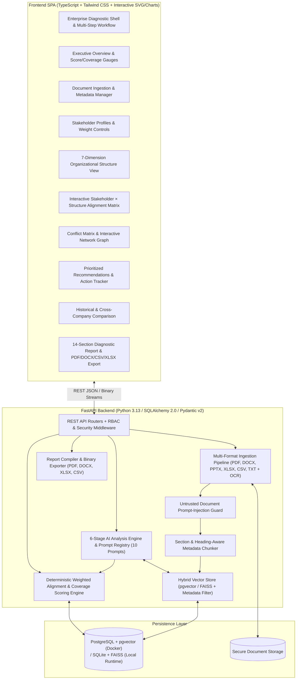

# Stakeholder–Structure Alignment Analyzer
## System Architecture, Database Schema, API Specification & Phased Implementation Plan

---

## 1. Architectural Overview

The **Stakeholder–Structure Alignment Analyzer** is a modular, evidence-backed organizational diagnostic platform designed to evaluate whether a company's organizational structure, governance mechanisms, capabilities, resource allocation, and decision-making processes align with the expectations of its internal and external stakeholders.



---

## 2. Project Folder Structure

```text
Alignment_Analyzer/
├── backend/
│   ├── __init__.py
│   ├── main.py                      # FastAPI application entrypoint & static SPA mount
│   ├── config.py                    # Environment settings & provider configuration
│   ├── database.py                  # SQLAlchemy 2.0 engine, session management, pgvector/SQLite setup
│   ├── models.py                    # 15 normalized ORM models
│   ├── schemas.py                   # Pydantic v2 request/response & LLM validation schemas
│   ├── security.py                  # Auth, RBAC, file validation, prompt-injection sanitization
│   ├── seed.py                      # Initial seed for Meta, Snap, Pinterest & baseline frameworks
│   ├── routers/
│   │   ├── companies.py             # Company CRUD & priority configuration
│   │   ├── assessments.py           # Assessment lifecycle, analysis execution, comparison, recalculation
│   │   ├── documents.py             # Multi-file upload, extraction, chunks, retry, archive
│   │   ├── stakeholders.py          # Stakeholder profiles, expectations, weight updates
│   │   ├── evidence.py              # Evidence repository, filtering, citations, quality metrics
│   │   ├── analysis.py              # Granular stage execution & manual overrides with audit logs
│   │   └── reports.py               # 14-section report generation & PDF/DOCX/CSV/XLSX exports
│   └── services/
│       ├── ingestion.py             # PDF, DOCX, PPTX, XLSX, CSV, TXT extraction + OCR fallback + chunking
│       ├── vector_store.py          # Embedding provider abstraction + pgvector/FAISS retrieval
│       ├── prompts.py               # 10 separate, strict evidence-grounded system prompts
│       ├── llm_provider.py          # Configurable OpenAI/Anthropic/Gemini + Evidence-Grounded Diagnostic Engine
│       ├── analysis_engine.py       # 6-stage analysis pipeline with JSON validation & auto-repair
│       ├── scoring_engine.py        # Transparent weighted alignment & evidence coverage calculator
│       ├── comparison_engine.py     # Periodic historical & cross-company comparison logic
│       └── report_generator.py      # PDF, DOCX, XLSX, CSV, and structured report builders
├── frontend/
│   ├── package.json
│   ├── tsconfig.json
│   ├── build.mjs                    # esbuild TypeScript/JSX bundler
│   ├── public/
│   │   └── index.html               # App shell with enterprise styling
│   └── src/
│       ├── main.tsx                 # Application bootstrap
│       ├── types.ts                 # TypeScript interfaces matching backend schemas
│       ├── api.ts                   # Typed REST client
│       ├── lib/
│       │   └── react-lite.ts        # Lightweight reactive JSX runtime
│       └── components/
│           ├── Sidebar.tsx          # Navigation & workflow stage indicator
│           ├── DashboardView.tsx    # Executive overview, gauges, and quick actions
│           ├── DocumentsView.tsx    # Multi-format upload, metadata editor, chunk inspector
│           ├── StakeholdersView.tsx # Internal/External profiles, weight sliders, expectation drill-down
│           ├── StructureView.tsx    # 7-Dimension organizational structure assessment
│           ├── MatrixView.tsx       # Interactive Stakeholder × Dimension Alignment Matrix + Drawer
│           ├── ConflictsView.tsx    # Stakeholder Conflict Matrix & Interactive SVG Network Graph
│           ├── RecommendationsView.tsx # Actionable recommendations by priority & status workflow
│           ├── ComparisonView.tsx   # Historical & Cross-Company trend charts and delta analysis
│           ├── ReportView.tsx       # 14-section interactive report viewer & PDF/DOCX/CSV/XLSX export
│           └── SettingsView.tsx     # Scoring weights, manual overrides, and immutable audit trail
├── migrations/
│   └── 001_initial_schema.sql       # Normalized PostgreSQL + pgvector DDL schema
├── sample_data/                     # Clearly labeled representative documents for Meta, Snap, Pinterest
├── tests/                           # Pytest suite covering all 10 required scenarios & unit tests
├── docker-compose.yml               # PostgreSQL (pgvector) + Backend + Frontend orchestration
├── Dockerfile.backend
├── .env.example
└── README.md
```

---

## 3. Normalized Database Schema (15 Models)

1. **`companies`**: `id`, `name`, `ticker`, `industry`, `description`, `analysis_priorities` (JSON list of company-specific focus areas), `created_at`, `updated_at`.
2. **`assessment_periods`**: `id`, `company_id` (FK), `title` (e.g., `FY2024 Assessment`), `fiscal_year`, `start_date`, `end_date`, `status` (`draft`, `processing`, `completed`, `archived`), `is_locked`, `version`, `overall_alignment_score`, `evidence_coverage_pct`, `last_analyzed_at`, `created_by`, `created_at`.
3. **`documents`**: `id`, `company_id` (FK), `assessment_period_id` (FK), `title`, `category`, `financial_year`, `publication_date`, `source_url`, `upload_date`, `file_type`, `file_path`, `file_size`, `version`, `processing_status`, `uploader`, `extracted_text`, `error_message`, `prompt_injection_flag`.
4. **`document_chunks`**: `id`, `document_id` (FK), `company_id` (FK), `assessment_period_id` (FK), `chunk_index`, `page_number`, `section_heading`, `content`, `token_count`, `source_url`, `publication_date`, `financial_year`, `document_category`, `embedding_json`.
5. **`stakeholders`**: `id`, `company_id` (FK), `assessment_period_id` (FK), `name`, `category` (`Internal` / `External`), `slug`, `importance_weight`, `influence_level`, `dependence_level`, `key_interests` (JSON), `concerns_and_risks` (JSON), `relevant_policies` (JSON), `potential_conflicts` (JSON), `alignment_score`, `evidence_coverage_pct`.
6. **`stakeholder_expectations`**: `id`, `stakeholder_id` (FK), `assessment_period_id` (FK), `title`, `description`, `requirement_weight`, `priority_category`, `is_discovered_from_docs`, `mapped_dimension_codes` (JSON).
7. **`organizational_dimensions`**: `id`, `assessment_period_id` (FK), `dimension_code` (`hierarchy`, `centralization`, `formalization`, `specialization`, `delegation`, `coordination`, `governance`), `dimension_name`, `suitability_classification`, `assessment_summary`, `strengths` (JSON), `weaknesses` (JSON), `evidence_count`, `confidence_level`.
8. **`organizational_units`**: `id`, `assessment_period_id` (FK), `dimension_id` (FK), `unit_name`, `unit_type`, `reporting_line`, `responsibilities`, `authority_scope`, `source_document_id` (FK), `evidence_classification`.
9. **`evidence_records`**: `id`, `company_id` (FK), `assessment_period_id` (FK), `document_id` (FK), `chunk_id` (FK), `stakeholder_id` (FK), `expectation_id` (FK), `organizational_dimension`, `extracted_statement`, `exact_quotation`, `document_name`, `page_number`, `section_heading`, `source_url`, `publication_date`, `financial_year`, `evidence_classification` (`FACT`, `COMPANY_CLAIM`, `THIRD_PARTY_CLAIM`, `INFERENCE`), `confidence_level`, `quality_score`, `quality_breakdown` (JSON: reliability, independence, recency, specificity, relevance), `is_contradictory`.
10. **`alignment_assessments`**: `id`, `assessment_period_id` (FK), `stakeholder_id` (FK), `expectation_id` (FK), `organizational_dimension`, `mapped_mechanisms` (JSON), `classification` (`Strong Alignment`, `Partial Alignment`, `Potential Misalignment`, `Insufficient Evidence`, `Not Applicable`), `numeric_score` (`4`, `3`, `1`, or `NULL`), `requirement_weight`, `rationale`, `root_cause_diagnosis` (JSON), `evidence_ids` (JSON), `evidence_quality_score`, `is_overridden`.
11. **`stakeholder_conflicts`**: `id`, `assessment_period_id` (FK), `stakeholder_a_id` (FK), `stakeholder_b_id` (FK), `stakeholder_a_name`, `stakeholder_b_name`, `conflicting_expectations`, `organizational_units_involved` (JSON), `current_resolution_mechanisms`, `structural_weaknesses`, `recommended_governance_mechanism`, `severity`, `evidence_ids` (JSON).
12. **`recommendations`**: `id`, `assessment_period_id` (FK), `stakeholder_id` (FK), `alignment_assessment_id` (FK), `organizational_dimension`, `title`, `identified_issue`, `suggested_organizational_change`, `expected_benefit`, `priority` (`Critical`, `High`, `Medium`, `Low`), `implementation_difficulty`, `possible_tradeoffs`, `status` (`Proposed`, `Accepted`, `Rejected`, `Implemented`), `evidence_ids` (JSON).
13. **`scoring_configurations`**: `id`, `assessment_period_id` (FK), `strong_alignment_value` (4), `partial_alignment_value` (3), `potential_misalignment_value` (1), `stakeholder_weights` (JSON), `requirement_weights` (JSON), `min_evidence_threshold`, `updated_by`, `updated_at`.
14. **`manual_overrides`**: `id`, `assessment_period_id` (FK), `alignment_assessment_id` (FK), `previous_classification`, `new_classification`, `previous_score`, `new_score`, `justification`, `evaluator_name`, `evaluator_role`, `created_at`.
15. **`audit_logs`**: `id`, `company_id`, `assessment_period_id`, `actor`, `role`, `action_type`, `entity_type`, `entity_id`, `before_state` (JSON), `after_state` (JSON), `justification`, `created_at`.

---

## 4. Phased Implementation Plan

- **Phase 1: Functional Foundation** — Database models, SQL migration schema, company & assessment period management, multi-format document ingestion (PDF, DOCX, PPTX, XLSX, CSV, TXT), security & prompt-injection guard, seed data for Meta, Snap, and Pinterest, and core frontend shell.
- **Phase 2: Knowledge Base & RAG** — Section-aware chunking, embedding provider abstraction, vector store indexing & similarity retrieval with metadata filtering, and evidence citation linkage.
- **Phase 3: AI Extraction Engine** — 10 dedicated system prompts, stakeholder & expectation extraction, 7-dimension organizational structure extraction, strict 4-tier evidence classification (`FACT`, `COMPANY_CLAIM`, `THIRD_PARTY_CLAIM`, `INFERENCE`), and evidence quality scoring.
- **Phase 4: Alignment Evaluation & Scoring Engine** — Requirement-to-structure mapping, alignment classification, transparent weighted scoring calculator, evidence coverage calculator, manual override workflow with audit trail, and interactive Alignment Matrix.
- **Phase 5: Diagnostics, Conflicts & Recommendations** — Root-cause diagnosis engine, Stakeholder Conflict Matrix & Network visualization, actionable Recommendation engine with status tracking, and Evidence Repository inspector.
- **Phase 6: Advanced Analytics, Reports & Testing** — Periodic historical & cross-company comparison module, 14-section report generator with PDF/DOCX/CSV/XLSX exports, representative multi-company sample document suite, and automated Pytest verification across all 10 test scenarios.

