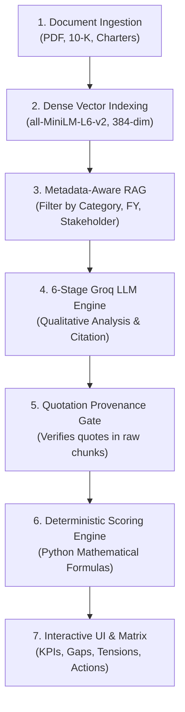

# Stakeholder–Structure Alignment Analyzer
## Comprehensive Feature Guide & Scoring Methodology Specification

> **Audience:** Technical Teams, Data Scientists, Product Managers, and Executive Stakeholders  
> **Platform Version:** 2.2.0 (Enterprise AI Diagnostic Engine)  
> **System Architecture:** Hybrid RAG + Groq LLM + Deterministic Math Scoring Engine

---

## 1. Executive Summary & Purpose

The **Stakeholder–Structure Alignment Analyzer** evaluates whether an organization's structural arrangements—its governance mechanisms, reporting lines, committee charters, delegation boundaries, and coordination protocols—are adequately designed to fulfill the expectations and legal requirements of its internal and external stakeholders.

Unlike standard chatbots or generic document summarizers, this platform is an **evidence-driven diagnostic intelligence system**. It enforces two foundational principles:

1. **Qualitative Context via AI:** Semantic retrieval (local dense embeddings) and Groq LLM inference are used exclusively for extracting evidence, identifying stakeholders, interpreting complex legal charters, and diagnosing organizational misalignments.
2. **Quantitative Determinism via Code:** All alignment scores, evidence coverage percentages, and weighted roll-ups are computed strictly using **deterministic Python algorithms**. The LLM is never permitted to invent, guess, or hallucinate numerical scores.

---

## 2. Core Architectural Pipeline

The system operates across six transparent, traceable stages:



---

## 3. The 7 Organizational Dimensions Evaluated

Every stakeholder expectation is mapped against seven structural dimensions defined in classical organizational theory and corporate governance:

| Dimension | Code | Definition & Core Diagnostic Question | Disclosed Meta Examples |
|---|---|---|---|
| **Hierarchy** | `HIER` | The vertical structure, layers of management, reporting channels, and escalation protocols. | CEO $\rightarrow$ Board of Directors; Chief Legal Officer escalation lines. |
| **Centralization** | `CENT` | The locus of decision-making authority (concentrated at executive level vs. distributed). | Dual-Class share voting control (Mark Zuckerberg holds ~61% voting power). |
| **Formalization** | `FORM` | The extent of written rules, standard operating procedures, and explicit charters. | Code of Conduct, Audit Committee Charter, AI Risk Management Framework. |
| **Specialization** | `SPEC` | Dedicated operational units, functional roles, and specialized technical expertise. | Data Privacy & Public Policy functions, Responsible AI teams. |
| **Delegation** | `DELE` | Formal empowerment and autonomous authority given to sub-committees or teams. | Privacy Committee authority, Audit Committee independent oversight. |
| **Coordination** | `COOR` | Cross-functional alignment, synchronization mechanisms, and information flows. | Joint safety briefings, cross-functional risk governance committees. |
| **Governance** | `GOVN` | Board oversight, committee structures, fiduciary stewardship, and independence. | Independent Audit Committee, ESG Committee, Independent Oversight Board. |

---

## 4. Evidence Classification & Source Provenance

Every diagnostic assessment is backed by verifiable textual evidence extracted from primary sources. The platform classifies evidence into four hierarchical tiers:

| Evidence Tier | Reliability Level | Description | Scoring Rule |
|---|---|---|---|
| **Fact** | Verified (Tier 1) | Direct disclosures of implemented structure, actual board actions, or SEC-audited data. | Eligible for **Strong Alignment (4.0)** |
| **Company Claim** | Self-Reported (Tier 2) | Commitments, forward-looking statements, or aspirational goals without verified execution. | **Capped at Partial Alignment (3.0)** — Unverified claims can never receive Strong Alignment. |
| **Third-Party Claim** | External (Tier 2) | Regulatory filings, external audits, court testimonies, or whistleblower disclosures. | Evaluated for potential structural friction or gaps. |
| **Inference** | Analytical (Tier 3) | Deductive reasoning drawn from absent disclosures or structural conflicts. | Used for Root Cause and Conflict identification. |

> [!IMPORTANT]
> **Anti-Hallucination Quotation Gate:** If an LLM-generated finding includes a citation or quotation that cannot be verified against the extracted document chunks in the database, the quotation provenance validator flags the record and treats the finding as **Insufficient Evidence**, preventing hallucinated citations.

---

## 5. Scoring Logic & Mathematical Formulas

The system separates **Organizational Alignment** from **Evidence Coverage**. Lack of evidence does not mean a company is structurally failing; it means the disclosure is insufficient.

### 5.1 Requirement-Level Classification Mapping

Each stakeholder requirement is assessed against an organizational dimension and classified into one of four states:

$$\text{Score}(r) = \begin{cases} 
4.0 & \text{if Classification = "Strong Alignment"} \\
3.0 & \text{if Classification = "Partial Alignment"} \\
1.0 & \text{if Classification = "Potential Misalignment"} \\
\text{NULL} & \text{if Classification = "Insufficient Evidence"} \\
\text{NULL} & \text{if Classification = "Not Applicable"}
\end{cases}$$

- **Why is 1.0 used for Misalignment instead of 0?** A score of 1.0 represents a severe misalignment with existing structural friction, whereas NULL represents total absence of evidence.
- **Why are Insufficient Evidence and N/A excluded from denominators?** If an expectation has no disclosed evidence, penalizing the alignment score directly would conflate **lack of data** with **organizational dysfunction**. Instead, lack of data is measured via **Evidence Coverage**.

---

### 5.2 Stakeholder-Level Alignment Score

Each stakeholder $s$ (e.g. Shareholders, Regulators, Users) has a set of applicable expectations $R_s$, where each requirement $r \in R_s$ carries an individual weight $w_r$ (default = 1.0; Critical = 2.0).

Let $A_s$ be the subset of requirements with valid assessed evidence:
$$A_s = \{r \in R_s \mid \text{Score}(r) \neq \text{NULL}\}$$

If $|A_s| \ge \text{Minimum Evidence Threshold}$ (default = 1):

1. **Calculate the Weighted Average Score:**
   $$\overline{S}_s = \frac{\sum_{r \in A_s} \text{Score}(r) \times w_r}{\sum_{r \in A_s} w_r}$$

2. **Normalize to Percentage (0% to 100%):**
   $$\text{Alignment Score}_s (\%) = \text{round}\left( \frac{\overline{S}_s}{4.0} \times 100, 1 \right)$$

*Example:* If a stakeholder has 2 requirements:
- Requirement 1: Partial Alignment (3.0), Weight = 1.0
- Requirement 2: Strong Alignment (4.0), Weight = 1.0
- $\overline{S} = \frac{(3.0 \times 1.0) + (4.0 \times 1.0)}{2.0} = 3.5$
- $\text{Alignment Score} = \frac{3.5}{4.0} \times 100 = \mathbf{87.5\%}$

---

### 5.3 Overall Organizational Alignment Score

Each stakeholder group is assigned an **Importance Weight** $W_s \in [0.1, 1.0]$ based on governance materiality:
- **Shareholders & Regulators:** Typically weighted 0.85 – 1.0 (statutory & legal fiduciary requirements).
- **Users & Communities:** Weighted 0.70 – 0.85 (operational & social license).
- **Suppliers & Partners:** Weighted 0.50 – 0.70.

Let $S_{\text{active}}$ be the set of stakeholders whose evidence meets the threshold:
$$\text{Overall Alignment Score} = \text{round}\left( \frac{\sum_{s \in S_{\text{active}}} \left[ \text{Alignment Score}_s \times W_s \right]}{\sum_{s \in S_{\text{active}}} W_s}, 1 \right)$$

This ensures that critical governance bodies (like Shareholders and Regulators) have proportionate impact on the enterprise health index.

---

### 5.4 Evidence Coverage Percentage

**Evidence Coverage** measures transparency and verifiable disclosure completeness:

1. **Per-Stakeholder Evidence Coverage:**
   $$\text{Coverage}_s (\%) = \text{round}\left( \frac{|A_s|}{|R_s \setminus \text{Not Applicable}|} \times 100, 1 \right)$$

2. **Overall Enterprise Evidence Coverage:**
   $$\text{Overall Evidence Coverage} (\%) = \text{round}\left( \frac{\sum |A_s|}{\sum |R_s \setminus \text{Not Applicable}|} \times 100, 1 \right)$$

---

## 6. Worked Case Study: Meta FY2025 Comprehensive Assessment

Based on the 19 official SEC filings, proxy statements, and committee charters indexed in Assessment Period 15:

| Metric | Empirical Result | Explanation |
|---|---|---|
| **Total Requirements Evaluated** | **19** | Total expectations across 6 major stakeholder groups. |
| **Strong Alignments (Green)** | **3** (15.8%) | Independent Audit Committee charter, financial reporting formalization, commercial contract standardization. |
| **Partial Alignments (Amber)** | **9** (47.4%) | Oversight Board exists but lacks binding authority over algorithmic design; AI safety commitments documented but lack independent board veto. |
| **Potential Misalignments (Rose)** | **1** (5.3%) | Dual-Class Share Structure (Class B 10:1 voting) creates direct structural misalignment with public shareholder expectations for board accountability. |
| **Insufficient Evidence (Slate)** | **6** (31.6%) | Direct worker safety metrics and specific cross-functional AI oversight reporting lines not disclosed in SEC filings. |
| **Overall Alignment Score** | **79.7%** | Computed from the 13 assessed requirements: $\frac{(3 \times 4.0) + (9 \times 3.0) + (1 \times 1.0)}{13} = \frac{12 + 27 + 1}{13} = \frac{40}{13} = 3.077 / 4.0 \approx 79.7\%$. |
| **Evidence Coverage** | **68.4%** | $\frac{13 \text{ assessed}}{19 \text{ applicable}} \times 100 = \mathbf{68.4\%}$. |
| **Identified Tensions & Conflicts** | **4** | Dual-class governance tension, Advertising monetization vs. privacy formalization, Fast-paced AI release vs. safety coordination, Shareholder returns vs. Metaverse CapEx. |
| **Actionable Recommendations** | **10** | Specific structural reforms with assigned organizational dimensions and implementation timeframes. |

---

## 7. Guided User Workflow for Team Members

When conducting a new company assessment, the platform follows five structured steps:

```
Step 1: Ingest Filings ➔ Step 2: Stakeholders ➔ Step 3: Org Structure ➔ Step 4: Alignment Matrix ➔ Step 5: Action Plan
```

1. **Ingest Filings (Documents Tab):**
   - Upload annual reports (10-K), proxy statements (DEF 14A), governance charters, or safety reports.
   - The system automatically chunks text, preserves page numbers (`[Page N]`), and indexes dense 384-dimensional vectors.
2. **Review Stakeholder Profiles:**
   - Inspect internal stakeholders (Shareholders, Employees, Management) and external stakeholders (Users, Regulators, Advertisers).
   - Adjust importance weights where specialized governance mandates require.
3. **Examine Organizational Structure (7 Dimensions):**
   - Review extracted committees, reporting lines, and delegation authorities directly traced to filing quotations.
4. **Inspect Alignment Matrix:**
   - The interactive 2D heat-grid maps Stakeholders (Rows) against Organizational Dimensions (Columns).
   - Click any cell to inspect the verbatim citation, page number, evidence classification, and AI interpretation.
5. **Review Conflicts & Action Plan:**
   - Review structural tensions where satisfying one stakeholder expectation creates organizational friction with another.
   - Review prioritized structural recommendations for board and executive action.

---

## 8. Summary Table for Quick Team Reference

| Question | Answer |
|---|---|
| **Does the AI determine the alignment percentage?** | **No.** The LLM determines the qualitative classification (*Strong, Partial, Misaligned, Insufficient*). Python math calculates all scores and percentages. |
| **Does missing data lower the score?** | **No.** Missing evidence is classified as *Insufficient Evidence* and excluded from the alignment score denominator; it reduces *Evidence Coverage %* instead. |
| **Can a company claim get Strong Alignment?** | **No.** Under Section 8 scoring rules, unverified company claims are capped at *Partial Alignment (3.0)*. *Strong Alignment (4.0)* requires verified factual implementation. |
| **What does 79.7% mean?** | Out of all requirements where empirical evidence was found, Meta's organizational structure achieves ~79.7% of maximum potential alignment, with the primary gap being partial oversight formalization and dual-class voting concentration. |
